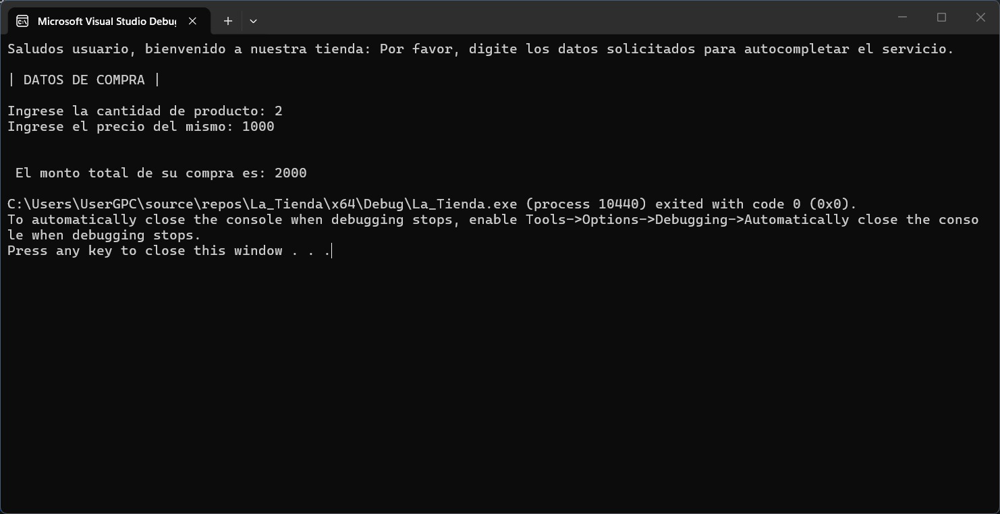
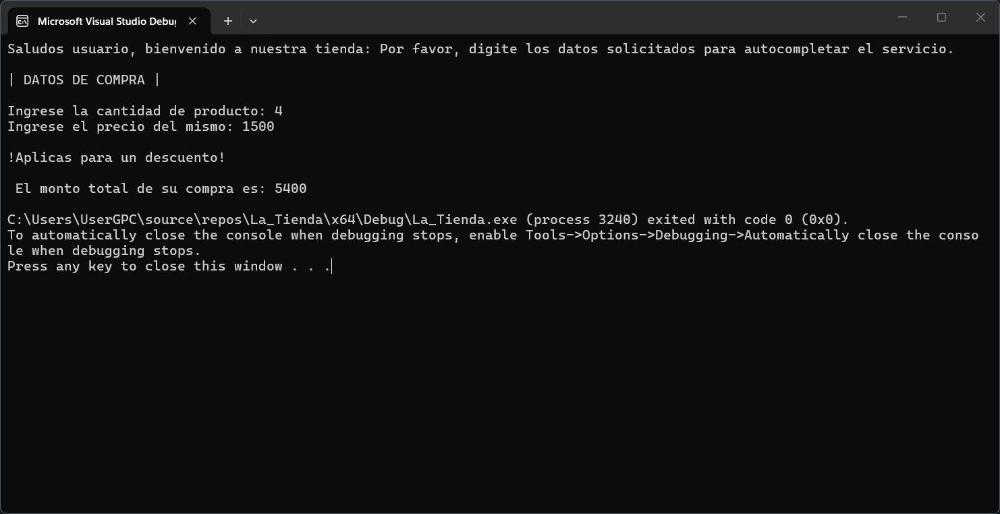
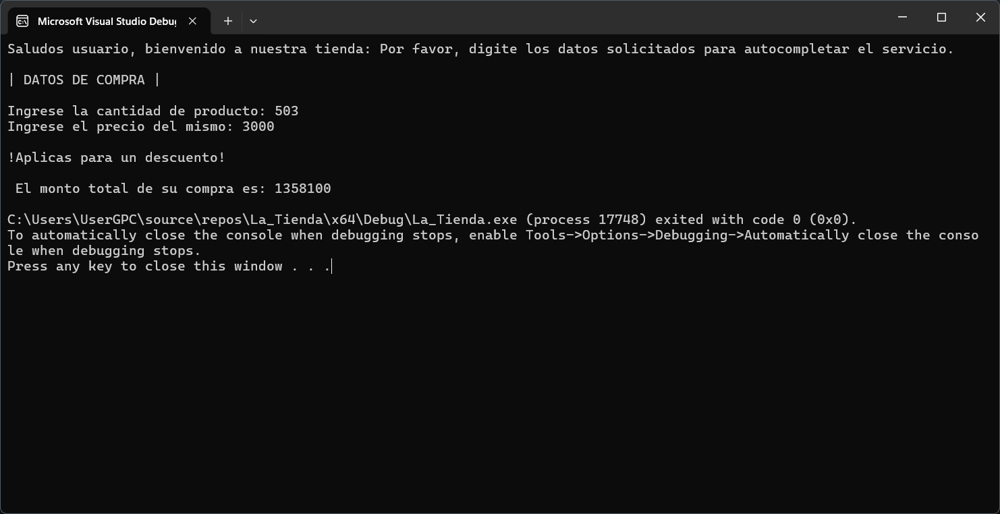

# Ejercicio: LA TIENDA

## Datos del estudiante
- **Nombre:** Kelvin Alberto Santana Beltre.
- **Matrícula:** *[2025-2485]*.

## Descripción breve del programa
Una aplicación de consola que registra la cantidad y el precio de un producto para calcular el total de una venta, aplicando automáticamente un 10% de descuento si el monto total alcanza o supera los 5,000.

## Lógica del programa
- **Datos de entrada:** Cantidad de productos y precio por unidad (valores enteros).
- **Datos que procesa:** 
  - Cálculo del total (multiplicación de cantidad por precio).
  - Condición para descontar el 10% al monto original si este cumple con el rango establecido.
- **Datos de Salida:** Impresión en pantalla del monto total final a pagar.

## Captura de pantalla del programa en ejecución
### Ejemplo No.1

### Ejemplo No.2

### Ejempplo No.3

## Estructura utilizada y su función
Para este desarrollo utilicé la descomposición mediante funciones y procedimientos, dividiendo el problema en piezas más pequeñas en lugar de escribir todo de golpe en el `main`:
- **Función con retorno (`int calcularTotalDePago`):** La utilicé para encerrar el cálculo . Recibe los parámetros, realiza la multiplicación y utiliza una estructura condicional **`if`** para evaluar si aplica el descuento, entregando únicamente el valor final ya procesado.
